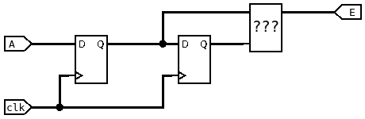
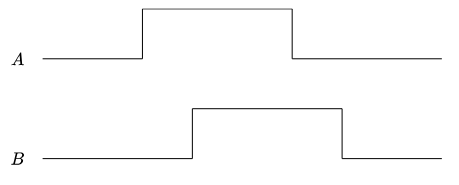
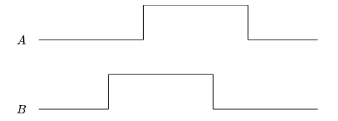

## Mini-Projet : Ecran Magique  

Ce petit projet en 3 séances nous propose de concevoir une version numérique du télécran, en utilisant la sortie HDMI de la carte DE10-Nano. Le _stylet_ numérique sera toujours déplacé par deux boutons, les deux encodeurs de la carte mezzanine.

Il est découpé en 4 sous-parties, qui ne sont volontairement pas très détaillées. Pour chaque partie, vous aurez à suivre la démarche suivante :
1. Concevoir un schéma pour répondre à la problématique
2. Implémenter la solution en VHDL
3. Simuler cette solution
4. Tester sur la carte

### Gestion des encodeurs
Dans cette partie, nous mettrons l'affichage de côté pour vous focaliser sur les encodeurs.

L'objectif est d'incrémenter la valeur d'un registre lorsque l'on tourne l'encodeur vers la droite, et de le décrémenter lorsqu'on le tourne vers la gauche. La taille du registre doit être configurable. On pourra choisir une taille de 10 dans cette partie pour afficher la valeur en binaire sur les LED.

Un encodeur renvoie deux signaux A et B en quadrature.

* Il y a deux conditions possible pour incrémenter le registre :
    1. Front montant sur A et B à l'état bas
    2. Front descendant sur A et B à l'état haut
* Il y a deux conditions possible pour décrémenter le registre :
    1. Front montant sur B et A à l'état bas
    2. Front descendant sur B et A à l'état haut

#### Détection des fronts
Pour détecter un front sur le signal A, on utilise deux bascules D placées en série et cadencées par la même horloge. À chaque front montant de l’horloge, une bascule D recopie son entrée D sur sa sortie Q, puis garde cette valeur jusqu’au front d’horloge suivant.

Ainsi, la première bascule contient la valeur actuelle de A, et la seconde contient la valeur de A au coup d’horloge précédent. Le bloc « ??? » compare ces deux valeurs :
* si A valait 0 avant et vaut 1 maintenant, on a un front montant
* si A valait 1 avant et vaut 0 maintenant, on a un front descendant
* si les deux valeurs sont identiques, A n’a pas changé et il n’y a pas de front.

La sortie E passe à 1 pendant un seul cycle d’horloge à chaque front détecté. Cela permet de modifier le compteur une seule fois par cran de l’encodeur.

La première bascule a aussi un rôle de synchronisation. Les signaux de l’encodeur viennent de l’extérieur et ne sont pas synchronisés avec l’horloge du FPGA. En les faisant passer par une bascule, on évite des comportements instables.

Pour connaître le sens de rotation, on applique cette structure aux deux voies A et B. On regarde ensuite l’état de l’autre voie au moment du front :
* incrémentation : front montant sur A avec B = 0, ou front descendant sur A avec B = 1  

* décrémentation : front montant sur B avec A = 0, ou front descendant sur B avec A = 1  

#### Implémentation de la solution en VHDL

##### Simulation

##### Contrôleur HDMI
###### À quels bits correspondent chaque composante couleur ?
Les bits de la sortie HDMI sont organisés comme suit :
* bits 23 à 16 : composante rouge
* bits 15 à 8 : composante verte
* bits 7 à 0 : composante bleue