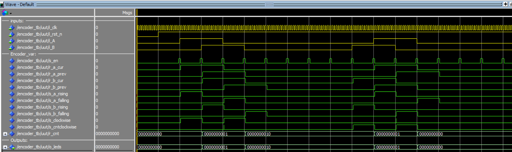

## Mini-Projet : Ecran Magique  

Ce petit projet en 3 séances nous propose de concevoir une version numérique du télécran, en utilisant la sortie HDMI de la carte DE10-Nano. Le _stylet_ numérique sera toujours déplacé par deux boutons, les deux encodeurs de la carte mezzanine.

Il est découpé en 4 sous-parties, qui ne sont volontairement pas très détaillées. Pour chaque partie, vous aurez à suivre la démarche suivante :
1. Concevoir un schéma pour répondre à la problématique
2. Implémenter la solution en VHDL
3. Simuler cette solution
4. Tester sur la carte

### Gestion des encodeurs
Dans cette partie, nous mettrons l'affichage de côté pour vous focaliser sur les encodeurs.

L'objectif est d'incrémenter la valeur d'un registre lorsque l'on tourne l'encodeur vers la droite, et de le décrémenter lorsqu'on le tourne vers la gauche. La taille du registre doit être configurable. On pourra choisir une taille de 10 dans cette partie pour afficher la valeur en binaire sur les LED.

Un encodeur renvoie deux signaux A et B en quadrature.

* Il y a deux conditions possible pour incrémenter le registre :
    1. Front montant sur A et B à l'état bas
    2. Front descendant sur A et B à l'état haut
* Il y a deux conditions possible pour décrémenter le registre :
    1. Front montant sur B et A à l'état bas
    2. Front descendant sur B et A à l'état haut

#### Détection des fronts
Pour détecter un front sur le signal A, on utilise deux bascules D placées en série et cadencées par la même horloge. À chaque front montant de l’horloge, une bascule D recopie son entrée D sur sa sortie Q, puis garde cette valeur jusqu’au front d’horloge suivant.


Ainsi, la première bascule contient la valeur actuelle de A, et la seconde contient la valeur de A au coup d’horloge précédent. Le bloc « ??? » compare ces deux valeurs :
* si A valait 0 avant et vaut 1 maintenant, on a un front montant
* si A valait 1 avant et vaut 0 maintenant, on a un front descendant
* si les deux valeurs sont identiques, A n’a pas changé et il n’y a pas de front.

La sortie E passe à 1 pendant un seul cycle d’horloge à chaque front détecté. Cela permet de modifier le compteur une seule fois par cran de l’encodeur.

La première bascule a aussi un rôle de synchronisation. Les signaux de l’encodeur viennent de l’extérieur et ne sont pas synchronisés avec l’horloge du FPGA. En les faisant passer par une bascule, on évite des comportements instables.

Pour connaître le sens de rotation, on applique cette structure aux deux voies A et B. On regarde ensuite l’état de l’autre voie au moment du front :
* incrémentation : front montant sur A avec B = 0, ou front descendant sur A avec B = 1  

* décrémentation : front montant sur B avec A = 0, ou front descendant sur B avec A = 1  


#### Implémentation de la solution en VHDL
```vhdl
library ieee;
use ieee.std_logic_1164.all;
use ieee.numeric_std.all;

entity encoder is
    generic (
        -- 5000000 @ 50 MHz = 100 ms
        -- 500000 @ 50 MHz = 10 ms
        PERIOD_S_EN : natural := 500000;
        WIDTH : natural := 10
    );
    port (
        i_clk   : in std_logic;
        i_rst_n : in std_logic;
        i_A     : in std_logic;
        i_B     : in std_logic;
        o_leds  : out std_logic_vector(WIDTH-1 downto 0)
    );
end entity encoder;

architecture rtl of encoder is
    signal s_en : std_logic := '0';

    signal r_a_cur  : std_logic := '0';
    signal r_a_prev : std_logic := '0';
    signal r_b_cur  : std_logic := '0';
    signal r_b_prev : std_logic := '0';

    signal s_a_rising  : std_logic;
    signal s_a_falling : std_logic;
    signal s_b_rising  : std_logic;
    signal s_b_falling : std_logic;

    signal s_clockwise     : std_logic;
    signal s_cntclockwise  : std_logic;

    signal r_cnt : unsigned(WIDTH-1 downto 0) := (others => '0');
begin
    -- Diviseur de fréquence pour avoir 100ms
    divider : process(i_clk, i_rst_n)
        variable counter : natural range 0 to PERIOD_S_EN-1 := 0;
    begin
        if (i_rst_n = '0') then
            counter := 0;
            s_en <= '0';
        elsif (rising_edge(i_clk)) then
            if (counter = PERIOD_S_EN-1) then
                counter := 0;
                s_en <= '1';
            else
                counter := counter + 1;
                s_en <= '0';
            end if;
        end if;
    end process divider;

    -- Echantillonage A et B
    sampling : process(i_clk, i_rst_n)
    begin
        if (i_rst_n = '0') then
            r_a_cur  <= '0';
            r_a_prev <= '0';
            r_b_cur  <= '0';
            r_b_prev <= '0';
        elsif (rising_edge(i_clk)) then
            if (s_en = '1') then
                r_a_cur  <= i_A;
                r_a_prev <= r_a_cur;
                r_b_cur  <= i_B;
                r_b_prev <= r_b_cur;
            end if;
        end if;
    end process sampling;

    -- Détection fronts
    s_a_rising  <= r_a_cur and not r_a_prev;
    s_a_falling <= not r_a_cur and r_a_prev;

    s_b_rising  <= r_b_cur and not r_b_prev;
    s_b_falling <= not r_b_cur and r_b_prev;

    -- Sens
    s_clockwise    <= (s_a_rising and not r_b_cur) or (s_a_falling and r_b_cur);
    s_cntclockwise <= (s_b_rising and not r_a_cur) or (s_b_falling and r_a_cur);

    -- Compteur
    cnt_dcnt : process(i_clk, i_rst_n)
    begin
        if (i_rst_n = '0') then
            r_cnt <= (others => '0');
        elsif (rising_edge(i_clk)) then
            if (s_en = '1') then
                if (s_clockwise = '1') then
                    r_cnt <= r_cnt + 1;
                elsif (s_cntclockwise = '1') then
                    r_cnt <= r_cnt - 1;
                end if;
            end if;
        end if;
    end process cnt_dcnt;

    o_leds <= std_logic_vector(r_cnt);
end architecture rtl;
```

##### Simulation
```vhdl
library ieee;
use ieee.std_logic_1164.all;
use ieee.numeric_std.all;

entity encoder_tb is
    generic (
        PERIOD_S_EN : natural := 10;
        WIDTH : natural := 10
    );
end entity encoder_tb;

architecture tb of encoder_tb is

    -- Constantes pour la simulation
    constant CLK_PERIOD : time := 20 ns; -- 50 MHz

    -- Signaux de test
    signal clk   : std_logic := '0';
    signal rst_n : std_logic := '0';
    signal A     : std_logic := '0';
    signal B     : std_logic := '0';
    signal leds  : std_logic_vector(WIDTH-1 downto 0);
    signal ended : boolean := false;

    constant DELAY : time := PERIOD_S_EN * CLK_PERIOD;

begin

    -- Instanciation du composant
    uut: entity work.encoder
        generic map (
            PERIOD_S_EN => PERIOD_S_EN,  
            WIDTH  => WIDTH
        )
        port map (
            i_clk   => clk,
            i_rst_n => rst_n,
            i_A     => A,
            i_B     => B,
            o_leds  => leds
        );

    -- Génération de l'horloge (50 MHz)

    stim_proc: process
    begin

        rst_n <= '0';
        A <= '0';
        B <= '0';
        wait for 10 * CLK_PERIOD;
        
        rst_n <= '1';
        wait for 10 * CLK_PERIOD;


        A <= '1'; wait for DELAY;
        B <= '1'; wait for DELAY;
        A <= '0'; wait for DELAY;
        B <= '0'; wait for DELAY;

        wait for DELAY * 4;

        B <= '1'; wait for DELAY;
        A <= '1'; wait for DELAY;
        B <= '0'; wait for DELAY;
        A <= '0'; wait for DELAY;

        wait for DELAY * 4;
        ended <= true;
        wait;
    end process stim_proc;

    clk_process: process
    begin
        clk <= '0';
        wait for (CLK_PERIOD/2);
        clk <= '1';
        wait for (CLK_PERIOD/2);
        if (ended = true) then
            wait;
        end if; 
    end process;

end architecture tb;
```

```vhdl
quit -sim

vlib work
vmap work work

vcom encoder.vhd
vcom encoder_tb.vhd

vsim work.encoder_tb

# INPUTS
add wave -divider inputs:
add wave -color yellow uut/i_clk
add wave -color yellow uut/i_rst_n
add wave -color yellow uut/i_A
add wave -color yellow uut/i_B

#ENCODER_VAR
add wave -divider Encoder_var:
add wave uut/s_en
add wave uut/r_a_cur
add wave uut/r_a_prev
add wave uut/r_b_cur
add wave uut/r_b_prev
add wave uut/s_a_rising
add wave uut/s_a_falling
add wave uut/s_b_rising
add wave uut/s_b_falling
add wave uut/s_clockwise
add wave uut/s_cntclockwise
add wave uut/r_cnt

#OUTPUTS
add wave -divider Outputs:  
add wave uut/o_leds

run -all
wave zoom full
```



##### Contrôleur HDMI
###### À quels bits correspondent chaque composante couleur ?
Les bits de la sortie HDMI sont organisés comme suit :
* bits 23 à 16 : composante rouge
* bits 15 à 8 : composante verte
* bits 7 à 0 : composante bleue